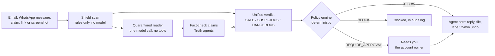

# FactFlow

FactFlow is a personal AI agent for people in India. Each person signs in with Google and gets their own agent that
**fact-checks** what they are asked to believe (WhatsApp forwards, links, screenshots, claims) and **runs their Gmail**
safely: it answers routine mail, sends files people ask for, and shields the inbox from scams and hidden prompt
injection. Its core rule is that **untrusted content is data, never a command**, and the person is asked whenever
something is risky.

- **Live:** <https://factflow-2.onrender.com> (Google Testing mode: only invited test users can sign in; the free
  server may take up to a minute to wake).
- **Private by default:** every check, email, file and setting belongs to one account. A verdict page is public only
  when its owner presses **Share**.

   

---

## 1. What FactFlow is

- **Truth:** paste a claim, a link or a PNG/JPG screenshot. A six-agent pipeline finds sources, reasons over them
  and returns a verdict. A code gate, not the model, turns weak verdicts into UNVERIFIED.
- **Shield:** every email or message is scanned by deterministic detectors that compare what a person sees with
  what an AI would read, and check the sender, links and scam patterns. A single quarantined model call reads the
  text; it has no tools. A policy engine decides every action the agent could take.
- **The mail agent** (per user, on their connected Gmail):
  - answers routine questions with a reply writer that sees one email's visible text, has no tools, and whose draft
    must pass code checks (no links, no ID or bank numbers, no sensitive topics, no accepted invitations);
  - sends files the user marked shareable in **My files** when a known contact asks for them;
  - labels and archives risky mail (`FactFlow/Quarantine`, `FactFlow/Phishing`), never deletes;
  - checks the user's own sent mail for leaks;
  - holds every outgoing message for 2 minutes with **Undo**, and puts anything unusual under **Needs you**.
- **Channels:** the website, a Chrome extension (per-user token), and WhatsApp (when Twilio is configured).

## 2. The problem

- Forwarded rumours spread on WhatsApp. In April 2020, two sadhus and their driver were lynched in Palghar,
  Maharashtra, after child-kidnapping rumours spread in the area
  ([source](https://en.wikipedia.org/wiki/2020_Palghar_mob_lynching)).
- Scam messages copy banks, KYC deadlines, UPI collect requests, lotteries and "digital arrest" calls by fake police
  or CBI officers. FactFlow has rule sets for these (section 3).
- AI email assistants add a new risk: an email can hide instructions that a person never sees but an assistant
  reads and follows (for example white-on-white text that asks the assistant to forward the inbox).

No statistics are given here because none have been cited yet.

## 3. What's new in FactFlow

[TEAM: review and edit]

Built on top of the earlier pipeline (see "Project history"), from the commit history since the rename:

- **Shield package** (`backend/shield/`, Phase 1, `e0cdf7f`): pure code, no network:
  - hidden-content detectors HC-01 to HC-12;
  - prompt-injection rules (`config/patterns.yml`);
  - phishing and brand-lookalike checks for Indian brands (`config/brands.yml`);
  - India-specific scam detectors SC-01 to SC-13;
  - PII redaction (Aadhaar with a Verhoeff check, cards with a Luhn check);
  - deterministic scoring;
  - the policy engine (P0 to P8, E-EGRESS, E-FINANCIAL, S1, strict and balanced modes);
  - HMAC-signed approvals;
  - a SHA-256 hash-chained audit log.
- **Inbox pipeline and LLM layer** (Phase 2, `d8d91bb`):
  - the quarantined reader;
  - claim fact-checks through the existing Truth agents;
  - explanations in the user's language;
  - a model-status report and a quota breaker.
  Phase 2 also hardened the existing pipeline: an SSRF-guarded fetcher (`services/safe_fetch.py`) and wrapping of
  untrusted text in agent prompts.
- **Read-only mail agent** (Phase 3, `d158060`):
  - a Gmail provider limited to `gmail.readonly` (later widened to modify + send for the autonomous agent);
  - a demo inbox of `.eml` files;
  - a task state machine;
  - strict and balanced policy modes;
  - `OPERATOR_TOKEN` for operator routes (replaced by Google sign-in in `fd73bfe`).
- **Sandbox assistant and red-team benchmark** (Phase 4, `427136e`, reviewed and fixed in `fc2620c`..`0f2cf52`):
  - Shield-off and Shield-on modes of a simulated email assistant;
  - 89 team-written benchmark cases;
  - a rules-only benchmark runner with saved run outputs.
- **WhatsApp channel** (Phase 5, `734abfd`):
  - a Twilio webhook with signature checks;
  - checks of text and images;
  - replies in English, Hindi or Telugu;
  - storage of only a salted hash of the sender's number;
  - STOP/START, a per-sender rate limit.
- **Accounts** (`fd73bfe`, `dac86e0`, `edee5ed`):
  - Sign in with Google (OIDC with PKCE); HttpOnly session cookies stored only as SHA-256, with CSRF tokens;
  - every table that holds user data is scoped to its owner; the operator token is gone;
  - per-user settings (policy mode, trusted domains) stored in the database;
  - extension tokens (`ffx_...`), WhatsApp link codes, sign out everywhere, delete account.
- **Autonomous mail agent** (`f62f6c8`, `a82aa94`):
  - Gmail with `gmail.modify` + `gmail.send` (full mail access is refused);
  - isolated reply writer, requested-file sending, quarantine labels, sent-mail leak checks;
  - a 2-minute undo window on every outgoing message, **Needs you**, **Write** (compose with a pre-send check);
  - a daily digest of what the agent did.
- **Finishing work** (2026-11-21): opt-in sharing of verdict pages, admin-only benchmark runs, WhatsApp shown as
  "coming soon" until configured, an optional keep-awake ping, and the benchmark dataset correction (section 6).

## 4. How it works



**How the model calls are isolated, as built** (`backend/shield/quarantine.py`, `backend/agents/inbox_pipeline.py`):

- **The quarantined reader** is the only component that reads the raw message with a model.
  - Its input is PII-redacted and wrapped in `<untrusted_content>` blocks that the message cannot close.
  - It has no tools and no memory, and its reply must be one JSON object that matches a schema. Anything else is
    discarded and counted as an analysis failure.
- **The explainer** only sees FactFlow's own findings plus short quoted strings, never the message.
- **The mail agent's planner and the policy engine** are plain code. They act only on structured verdict fields.
  An action that a message asks for is recorded as a blocked step (rule P1, untrusted origin).
- Both model calls use the same model (`NANO_MODEL`, default `openai/gpt-oss-20b`). The isolation comes from what
  each call is given and allowed to do, not from using two different models.
- **Rules-only mode** (`mode: rules`, or `INBOX_USE_LLM=false`) makes no model calls at all.

**Truth pipeline:**

- **Intake** (Nano) extracts the claim.
- **Source Tracer** (Nano) gathers sources from Google Fact Check, NewsAPI, GDELT and DuckDuckGo, ranks them by
  source tier and marks stance.
- **Deep Reasoning** (Ultra, `openai/gpt-oss-120b`) runs only on low confidence or critical claims.
- **Explainer** and **Harm Assessor** (Nano) write the explanation and the harm rating.
- `decide_verdict` in `backend/agents/orchestrator.py` returns UNVERIFIED unless at least 2 tier 1-2 sources exist,
  confidence is at least 0.6, and the model did not report missing context without a contradiction.
- Screenshots are read by Gemma 4 through the Gemini API when `GEMINI_API_KEY` is set, otherwise by Tesseract. The
  image reader only transcribes; it never decides a verdict.

## 5. Status

Labels: REAL AND TESTED · TESTED WITH FIXTURES OR STAND-IN MODELS ONLY · NOT LIVE-TESTED · STUBBED · PENDING · NOT BUILT.

| Feature | Status | Real vs simulated | Evidence |
|---|---|---|---|
| Truth claim pipeline (six agents, verdict gate) | REAL AND TESTED | Real model calls and real source searches | backend tests; one live run in `docs/AUDIT.md` section 9 |
| Truth accuracy bench (30 claims) | PENDING | | no saved result; `/api/accuracy` reports no complete run |
| Screenshot reading (Gemma 4 / Tesseract) | TESTED WITH FIXTURES OR STAND-IN MODELS ONLY | Image reader only transcribes | `tests/test_gemma.py`, `tests/test_screenshot.py` |
| Sign in with Google, sessions, per-user data | REAL AND TESTED | Live on the deployed site in Testing mode | `tests/test_accounts.py` (two users, every private route) |
| Verdict sharing (private until the owner shares) | REAL AND TESTED | | `tests/test_accounts.py` |
| Web pages (home, my verdicts, tracker, Shield, Needs you, Write, settings, about, accuracy) | REAL AND TESTED | | `npm run build`; frontend unit tests; deployed |
| Chrome extension (per-user token) | NOT LIVE-TESTED | | no automated tests |
| Android overlay | NOT BUILT | Design mockup only (`android/overlay_mockup.html`) | |
| Shield detectors (HC-01..12, injection rules, SC-01..13, brand lookalikes) | REAL AND TESTED | Deterministic, no model | `backend/tests/shield/`, `tests/test_benchmark_realism.py` |
| Policy engine (P0-P8, strict/balanced, per user) | REAL AND TESTED | Deterministic | `tests/shield/test_shield_policy.py`, `tests/test_mail_actions.py` |
| Approvals (HMAC token, single use) and Needs you | REAL AND TESTED | | `tests/shield/test_shield_approvals.py`, mail-agent tests |
| Audit log (SHA-256 hash chain, `GET /api/audit/verify`) | REAL AND TESTED | | `tests/shield/test_shield_audit.py` |
| Inbox pipeline, rules-only mode | REAL AND TESTED | No model calls | inbox tests; `docs/MEASUREMENTS.md` |
| Inbox pipeline, full mode (quarantined reader, claim checks, explainer) | TESTED WITH FIXTURES OR STAND-IN MODELS ONLY | Real model calls when quota allows | stand-in models in `tests/standins.py` |
| Mail agent on Gmail (labels, replies, files, undo window, sent-mail checks) | TESTED WITH FIXTURES OR STAND-IN MODELS ONLY | Real sends through the user's Gmail | fake Gmail API (`tests/gmail_fake.py`), `tests/test_mail_actions.py`, `tests/test_mail_permissions.py`; live two-account run pending (`docs/GMAIL_SETUP.md`) |
| Mail agent with the demo inbox (`.eml`) | REAL AND TESTED | Outgoing steps reach the simulated outbox | mail-agent tests |
| Sandbox assistant, Shield on | REAL AND TESTED | Simulated outbox only | `tests/test_phase4_sandbox_benchmark.py` |
| Sandbox assistant, Shield off (vulnerable baseline) | TESTED WITH FIXTURES OR STAND-IN MODELS ONLY | Simulated outbox only; off unless `ALLOW_VULNERABLE_DEMO=true` | one recorded real run: `backend/data/demo_recordings/demo_run_20261022_174542.json` |
| Attack-success rates (20 runs per attack, both modes) | PENDING | | `backend/scripts/measure_attacks.py` is ready; needs model quota |
| Red-team benchmark, rules-only | REAL AND TESTED | | `docs/benchmark_runs/` |
| Red-team benchmark, LLM mode | PENDING | | no saved run |
| WhatsApp via Twilio | TESTED WITH FIXTURES OR STAND-IN MODELS ONLY | Shown as "coming soon" until Twilio is configured | `tests/test_whatsapp.py` (fake Twilio API) |
| WhatsApp via Meta Cloud API | STUBBED | Signature check and parsing exist; replies are dry-run only | `tests/shield/test_shield_whatsapp.py` |
| Safe fetcher (SSRF guard), short-link expansion, DNS checks | TESTED WITH FIXTURES OR STAND-IN MODELS ONLY | Expansion and DNS checks are off by default | `tests/test_safe_fetch.py` |
| Celery queue mode (`USE_CELERY=true`) | NOT LIVE-TESTED | | no automated tests |
| Hardware / edge device | NOT BUILT | Postponed | |

## 6. Honest numbers

Rules-only red-team benchmark, run `3600b988f57643e0981ed5a054c908e0`, 2026-11-21
(`docs/benchmark_runs/rules_3600b988f57643e0981ed5a054c908e0.json`; details and history in [docs/BENCHMARK.md](docs/BENCHMARK.md)):

| Metric | Result |
|---|---|
| Cases | 89 (54 attack, 35 benign) |
| Detection rate (attack flagged SUSPICIOUS or DANGEROUS) | 100.0 % (54/54) |
| False-positive rate (benign flagged SUSPICIOUS or DANGEROUS) | 0.0 % (0/35) |
| Policy level (attacks where no consequential action was allowed without approval) | 100.0 % (54/54) |
| Latency p50 / p95 per email | 39.7 / 50.1 ms |
| Model tokens used | none (rules only) |

- **How it got here.** In October the rules flagged 30 of 35 benign cases and missed 3 attacks. Each case was
  diagnosed (`docs/benchmark_runs/benign_case_diagnosis_2026-10-23.txt`):
  - 26 were "benign" emails whose plain-text and HTML parts said different things. HC-12 now grades that: low when
    the wording differs, medium when the plain part adds a scam pitch, links or numbers, critical when it adds AI
    instructions.
  - 7 were brand mail on fake domains (`hdfcbank.example`), which is impersonation. Those test files now use the
    brands' real domains. `tests/test_benchmark_realism.py` proves the same mail from the fake domain is still
    flagged. Expected labels were never changed.
- **The 3 former misses** (`att_hc09_attachment_invoice`, `att_inj_secrecy_02`, `att_inj_tool_02`) are caught by
  injection phrasings added after we saw them. So 54/54 includes rules fitted to this test set: read it as "known
  gaps closed", not as an unbiased detection rate.
- **These are team-written cases, not an independent evaluation.**
- **PENDING:** the attack-success rates in both modes and LLM-mode results. Only one real Shield-off run is recorded,
  and it is one run, not a rate.

## 7. Known limits

- **CSS hiding gaps.** `@media` rules are evaluated for one desktop screen in light mode only. Text hidden only on
  phone widths, only in dark mode, or inside `@supports` blocks is missed.
- **Heuristic detection** can miss new phrasings; the benchmark is team-written and partly fitted (section 6).
- **Kept in memory, lost on restart:** Gmail connections in progress (10-minute state), rate limits, and emails
  uploaded to the demo inbox. Accounts, settings, queued mail and approvals are in the database.
- **Google Testing mode:** only listed test users can sign in, and their Gmail grants can expire after about a week
  (the user reconnects). Going public needs Google's security review for `gmail.modify`.
- **Free hosting:** the Render free server sleeps after about 15 idle minutes, and a sleeping agent checks no mail.
  `KEEP_ALIVE_URL` keeps it awake (about 720 of the 750 free hours a month). The free Postgres database expires
  30 days after creation unless upgraded.
- **Benchmark domains:** attack cases use placeholder domains (`.example`, `.test`, `.invalid`); seven benign cases
  use real brand domains.
- **Hindi and Telugu OCR:** the development machine's Tesseract has only English data (`eng`, `osd`). Hindi and
  Telugu screenshots need Gemma (`GEMINI_API_KEY`) or the `hin`/`tel` Tesseract data. The WhatsApp reply says when
  this applies.
- **Helplines** (1930 and cybercrime.gov.in) are marked HUMAN MUST VERIFY (`backend/shield/config/helplines.yml`).
- **Hindi and Telugu reply templates** need native-speaker review (`backend/shield/config/whatsapp_templates.yml`).
- **Model quota:** Groq's free tier has a daily token limit. When it runs out, Shield answers rules-only and says so
  (`llm_status`). The Truth pipeline needs the model, so its checks degrade or fail until the quota resets.
- **Private-person and self-harm rule** (Truth) is a keyword check, not a classifier. It can miss unfamiliar
  phrasings, and it withholds some claims it did not need to.
- **Source stance is not part of the verdict gate.** The gate counts tier 1-2 sources whatever their stance.
- **Screenshots** must be PNG or JPG up to 5 MB; other formats are rejected.
- **Voice notes and Meta WhatsApp replies** are not supported.

## 8. Privacy

- **One account, one agent.** Every row with user data carries its owner's id, and every route filters by it.
  `tests/test_accounts.py` signs in two users and checks that neither can read, change or even detect the other's
  checks, emails, files, queued mail, alerts or settings.
- **Verdict pages are private** until their owner presses **Share**; **Stop sharing** closes them again.
- **Sign-in:** FactFlow stores the Google account id, email, name and picture. Session cookies are HttpOnly and only
  their SHA-256 is stored.
- **Gmail:** tokens are Fernet-encrypted (`TOKEN_ENCRYPTION_KEY`). Raw email bytes are not stored; analysed emails
  keep the verdict (visible and hidden text) for their owner. The reply writer sees one email's visible text, PII
  redacted.
- **My files** are stored for their owner and sent only when marked shareable.
- **Claim text** is PII-redacted. **WhatsApp senders** are stored only as a salted SHA-256, and WhatsApp verdicts
  have the message text removed (`docs/DECISIONS.md` D77-D78).
- **The audit log** keeps PII-redacted payloads in a hash chain. When an account is deleted, its records are kept
  for the chain but detached from the person; everything else the user owns is deleted and Gmail access revoked.

## 9. Setup on Windows

Tested on Windows 11 with Python 3.11 and Node 24; PostgreSQL 16 is optional.

**Prerequisites:**

- Python 3.11 (`py -3.11`) and Node.js 18 or newer.
- Optional: PostgreSQL. Without it the backend falls back to a local SQLite file.
- Optional: Tesseract OCR, with the `hin` and `tel` language data for Hindi and Telugu screenshots.

**Backend** (PowerShell):

```powershell
git clone https://github.com/bbsarada07/FactFlow.git
cd FactFlow\backend
py -3.11 -m venv venv
venv\Scripts\python -m pip install -r requirements.txt
venv\Scripts\python -m pip install -r requirements-dev.txt     # for the tests
Copy-Item .env.example .env                                     # then fill in the values, see below
venv\Scripts\python -m uvicorn main:app --reload --port 8000    # development
```

**Do not use `--reload` during a demo.** A reload restarts the server and drops what is kept in memory (Gmail
connections in progress, rate limits). For a demo, run
`venv\Scripts\python -m uvicorn main:app --port 8000`. Check it with `http://localhost:8000/health`; the API explorer
is at `http://localhost:8000/docs`.

**Frontend:**

```powershell
cd FactFlow\frontend
npm install
Copy-Item .env.local.example .env.local      # NEXT_PUBLIC_API_URL=http://localhost:8000
npm run dev                                  # http://localhost:3000
```

**Tests:**

```powershell
cd FactFlow\backend
venv\Scripts\python -m pytest -q
cd ..\frontend
npm test
npm run build
```

To run the database tests on PostgreSQL as well, set `FACTFLOW_TEST_DATABASE_URL` to a disposable database. The
tests drop its tables; never point it at your real database.

**Sign in locally:** set `GOOGLE_CLIENT_ID`, `GOOGLE_CLIENT_SECRET` and `SECRET_KEY` (see
[docs/GMAIL_SETUP.md](docs/GMAIL_SETUP.md)) and add your address as a test user in Google Cloud.

**Benchmark (rules only, no model calls):** sign in with an address listed in `ADMIN_EMAILS`, open
**Shield → Advanced → Benchmark** and press **Run**. Anyone signed in can read the latest result
(`GET /api/benchmark/latest`).

**Gmail and WhatsApp:** see [docs/GMAIL_SETUP.md](docs/GMAIL_SETUP.md) and [docs/WHATSAPP_SETUP.md](docs/WHATSAPP_SETUP.md).

### backend/.env variables

Names only. Never commit `.env`. To generate a random secret:
`py -3.11 -c "import secrets; print(secrets.token_urlsafe(32))"`.

**Models and evidence sources**

| Name | What it is |
|---|---|
| `GROQ_API_KEY` | Groq key (console.groq.com/keys). Needed for Truth and for Shield's full mode |
| `GROQ_BASE_URL` | OpenAI-compatible endpoint; default Groq |
| `NANO_MODEL`, `ULTRA_MODEL`, `VISION_MODEL` | Model ids (defaults `openai/gpt-oss-20b`, `openai/gpt-oss-120b`, a Groq vision model) |
| `NEWS_API_KEY` | NewsAPI key (optional evidence source) |
| `GOOGLE_FACT_CHECK_API_KEY` | Google Fact Check Tools API key (optional evidence source) |

**Database, queue and app**

| Name | What it is |
|---|---|
| `DATABASE_URL` | Listed in `.env.example` but not read by the backend; use `ASYNC_DATABASE_URL` |
| `ASYNC_DATABASE_URL` | `postgresql+asyncpg://...`; if PostgreSQL is unreachable the backend falls back to SQLite |
| `REDIS_URL`, `CELERY_BROKER_URL`, `CELERY_RESULT_BACKEND`, `USE_CELERY` | Optional Celery queue mode |
| `SECRET_KEY` | At least 32 random characters; signs view tokens (generate as above) |
| `FRONTEND_URL`, `BACKEND_URL`, `ENVIRONMENT`, `DEBUG` | App URLs and mode. Google callbacks are built from `FRONTEND_URL` |
| `KEEP_ALIVE_URL`, `KEEP_ALIVE_MINUTES` | Optional: the backend requests this URL (its own `/health`) every N minutes so free hosting does not sleep |
| `DEEP_REASONING_THRESHOLD` | Confidence below which Truth escalates to Deep Reasoning |
| `MAX_REQUESTS_PER_MINUTE` | Rate limit on the public check routes |
| `CACHE_TTL_HOURS` | Listed in `.env.example` but not read by the backend |

**Accounts**

| Name | What it is |
|---|---|
| `GOOGLE_CLIENT_ID`, `GOOGLE_CLIENT_SECRET` | The Google OAuth client, used for sign-in and Gmail |
| `ADMIN_EMAILS` | Comma-separated; may run the benchmark and read the system audit log |
| `ALLOWED_EMAILS` | Optional allow-list on top of Google's test users; empty means any test user |
| `SESSION_DAYS` | Session length (default 30) |

**Shield**

| Name | What it is |
|---|---|
| `APPROVAL_SECRET` | At least 32 characters; signs approval tokens; empty means no approvals (such steps are blocked) |
| `INBOX_USE_LLM`, `INBOX_MAX_CLAIMS` | Allow model calls in the inbox pipeline; maximum claims fact-checked per message |
| `ENABLE_LINK_EXPANSION`, `ENABLE_DNS_CHECKS` | Follow short links (SSRF-guarded); look up SPF/DMARC records. Both default to off |
| `ALLOW_VULNERABLE_DEMO` | `true` enables the Shield-off sandbox; default `false` |

**Gmail** (see docs/GMAIL_SETUP.md)

| Name | What it is |
|---|---|
| `GOOGLE_REDIRECT_URI` | Optional; defaults to `FRONTEND_URL` + `/api/mail/gmail/callback` |
| `TOKEN_ENCRYPTION_KEY` | Fernet key: `py -3.11 -c "from cryptography.fernet import Fernet; print(Fernet.generate_key().decode())"` |
| `MAIL_POLL_ENABLED`, `MAIL_POLL_SECONDS`, `MAIL_FIRST_SYNC`, `MAIL_MAX_PER_SYNC`, `MAIL_AGENT_MAX_PER_MINUTE` | Gmail polling and mail-agent limits |
| `MAIL_SEND_DELAY_SECONDS`, `MAIL_APPROVAL_TTL_HOURS`, `AUTO_REPLY_MAX_CHARS` | Undo window (120 s), how long Needs you items stay open, reply length |
| `MAX_FILE_BYTES`, `MAX_FILES_PER_USER`, `MAIL_SENT_SCAN_PER_SYNC`, `DIGEST_HOURS` | My files limits, sent-mail checks per sync, digest interval |

**WhatsApp** (see docs/WHATSAPP_SETUP.md)

| Name | What it is |
|---|---|
| `WHATSAPP_PROVIDER` | `twilio` (default) or `meta` |
| `TWILIO_ACCOUNT_SID`, `TWILIO_AUTH_TOKEN`, `TWILIO_WHATSAPP_FROM` | Twilio sandbox credentials and number |
| `META_APP_SECRET` | Only for `WHATSAPP_PROVIDER=meta` |
| `PUBLIC_BASE_URL` | Public https origin Twilio calls (your tunnel) |
| `WHATSAPP_HASH_SALT` | At least 16 random characters; never change it once in use |
| `WHATSAPP_MAX_PER_HOUR` | Checks per sender per hour (default 10) |

**Read from the environment but missing from `.env.example`:** `GEMINI_API_KEY` (Gemma 4 screenshot reading),
`VISION_PROVIDER` (`gemini`, `groq` or `none`) and `TESSERACT_CMD` (path to `tesseract.exe` if it is not on PATH).

## 10. Security notes

- **No shared secret in the browser.** Users sign in with Google; the frontend bundle contains no token and no
  `NEXT_PUBLIC_` secret. Unsafe requests need the CSRF token, and the extension uses its own revocable token.
- **Least Gmail access.** `gmail.modify` + `gmail.send`; full mail access is refused and revoked. FactFlow never
  deletes mail, and every message it sends waits 2 minutes with Undo.
- **Content never gives orders.** Instructions found in an email become a blocked step (rule P1); replies come from
  an isolated writer whose draft is checked by code before it is queued.
- **Keep the Google app in Testing mode**, and connect only accounts that agreed to it.
- **Never commit `.env`.** It is git-ignored; `.env.example` holds names only.

## 11. Repository map

```
FactFlow/
├── backend/            FastAPI app
│   ├── agents/         Truth agents and the inbox pipeline
│   ├── api/            HTTP routes
│   ├── shield/         Shield: detectors, policy, approvals, audit, providers (pure code)
│   ├── services/       Mail agent, WhatsApp service, Gmail account, safe fetcher
│   ├── data/           Demo emails, benchmark cases, sample verdicts, demo recording
│   ├── scripts/        Benchmark generator, measurements, attack measurement, demo recorder
│   └── tests/          Backend tests and fixtures
├── frontend/           Next.js 14 (Pages Router)
├── extension/          Chrome MV3 extension
├── android/            Overlay design mockup
└── docs/               Documentation (below)
```

| Document | What it covers |
|---|---|
| [docs/API_CONTRACT.md](docs/API_CONTRACT.md) | Shield API routes and JSON, for the frontend |
| [docs/BENCHMARK.md](docs/BENCHMARK.md) | Red-team benchmark results, failures and limits |
| [docs/benchmark_runs/](docs/benchmark_runs/) | Saved benchmark run outputs |
| [docs/DEMO_SCRIPT.md](docs/DEMO_SCRIPT.md) | The 4-minute demo |
| [docs/DECISIONS.md](docs/DECISIONS.md) | Design decisions by phase |
| [docs/GMAIL_SETUP.md](docs/GMAIL_SETUP.md) | Google sign-in and Gmail setup, live checks |
| [docs/WHATSAPP_SETUP.md](docs/WHATSAPP_SETUP.md) | Twilio WhatsApp sandbox setup |
| [docs/MEASUREMENTS.md](docs/MEASUREMENTS.md) | Latency and token measurements |
| [docs/AUDIT.md](docs/AUDIT.md) | Phase 0 audit (a dated snapshot) |
| [docs/REVIEW_PHASE4_5.md](docs/REVIEW_PHASE4_5.md) | Review of the Phase 4 work and the Phase 5 build |
| [docs/PHASE7_FACTS.md](docs/PHASE7_FACTS.md) | Facts and sources behind this README |
| [docs/RENAME_NOTES.md](docs/RENAME_NOTES.md) | Notes from the rename |

## Project history

FactFlow builds on two earlier projects by the same team, each built for another hackathon:

- **NemesisAI**, the misinformation fact-checker that became FactFlow's Truth half. FactFlow is its renamed
  continuation. The work that existed before FactFlow is listed below by commit.
- **Sentinel**, the team's secure email-agent project. From it, ideas from its policy engine were adapted:
  - recomputed argument provenance;
  - fail-closed evaluation;
  - the egress URL check;
  - the recipient allowlist;
  - the monotonic policy store.
  Its executor/ledger pattern became the simulated outbox. Its detectors were rewritten for real email parsing, and
  its seed-specific parser and planner were not ported (`docs/AUDIT.md` section 3).

AI coding assistants were used to write parts of the code.

[TEAM: confirm this wording against the Hack with Aditya rules on prior work and AI-assisted code before submitting]

Work that existed before FactFlow, by commit. Dates are taken from `git log` (IST).

| Commit | Date | Work |
|---|---|---|
| `1620623` | 2026-10-19 | First commit: six-agent pipeline, FastAPI backend, Next.js frontend, Chrome extension, Android mockup |
| `6e3d216` | 2026-10-20 | Public verdict registry, honest-uncertainty gate, corrections in EN/HI/TE |
| `698036d`, `3b35caa` | 2026-10-20 | Frontend v2: public verdict pages, registry, share buttons |
| `5a1908d`, `3f0f721`, `f371e5b` | 2026-10-20 | Public record fields, repeat-detection fix, extension options page |
| `6e9e1d9`, `5e761f8`, `91b4198` | 2026-10-21 | GDELT source, source tiers, grounding rule, 30-claim bench |
| `869f341`–`b3af000` | 2026-10-21 | Spelling variants, named-source summaries, sourced homepage line, `/health` build commit |
| `62d03ba` | 2026-10-21 | Private-person and self-harm rule |
| `c27dba5` | 2026-10-21 | Gemma 4 via the Gemini API |
| `0f05b6c`–`284fc28` | 2026-10-21 | Split routing (Groq verdicts, Gemma 4 screenshots only), screenshot checks, stance disagreement line, unsourced figures removed, `/health` key flags, `/accuracy` page |

The rename to FactFlow followed on `ac65d3b`..`3558180`; the FactFlow work is in section 3.

## License

[MIT](LICENSE)
