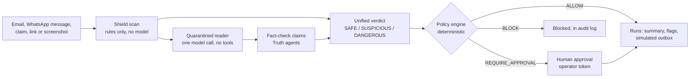

# FactFlow

FactFlow checks the messages people in India are asked to believe or act on: WhatsApp forwards, emails and web
pages. Its core rule is that **untrusted content is data, never a command**, and a human approves any risky action.

It has two halves:

- **Truth** fact-checks a claim against published sources and says plainly when it cannot tell.
- **Shield** finds hidden text, prompt injection and scam patterns in emails and messages, and puts every action an
  AI assistant might take behind a deterministic policy gate, human approvals and a tamper-evident audit log.

   

---

## 1. What FactFlow is

- **Truth:** paste a claim, a link or a PNG/JPG screenshot. A six-agent pipeline finds sources, reasons over them
  and returns a verdict. A code gate, not the model, turns weak verdicts into UNVERIFIED.
- **Shield:** give it an email (`.eml` or pasted) or a WhatsApp message. Deterministic detectors compare what a
  person sees with what an AI would read, and check the sender, links and scam patterns. A single quarantined model
  call reads the text; it has no tools. A policy engine decides every action the mail agent could take. Anything
  that sends data out needs a human approval, and even then it only reaches a **simulated outbox**.

## 2. The problem

- Forwarded rumours spread on WhatsApp. In April 2020, two sadhus and their driver were lynched in Palghar,
  Maharashtra, after child-kidnapping rumours spread in the area
  ([source](https://en.wikipedia.org/wiki/2020_Palghar_mob_lynching)).
- Scam messages copy banks, KYC deadlines, UPI collect requests, lotteries and "digital arrest" calls by fake police
  or CBI officers. FactFlow has rule sets for these (section 3).
- AI email assistants add a new risk: an email can hide instructions that a person never sees but an assistant
  reads and follows (for example white-on-white text that asks the assistant to forward the inbox).

No statistics are given here because none have been cited yet.

## 3. What's new in FactFlow

[TEAM: review and edit]

Built on top of the earlier pipeline (see "Project history"), from the commit history since the rename:

- **Shield package** (`backend/shield/`, Phase 1, `e0cdf7f`): pure code, no network:
  - hidden-content detectors HC-01 to HC-12;
  - prompt-injection rules (`config/patterns.yml`);
  - phishing and brand-lookalike checks for Indian brands (`config/brands.yml`);
  - India-specific scam detectors SC-01 to SC-13;
  - PII redaction (Aadhaar with a Verhoeff check, cards with a Luhn check);
  - deterministic scoring;
  - the policy engine (P0 to P8, E-EGRESS, E-FINANCIAL, S1, strict and balanced modes);
  - HMAC-signed approvals;
  - a SHA-256 hash-chained audit log.
- **Inbox pipeline and LLM layer** (Phase 2, `d8d91bb`):
  - the quarantined reader;
  - claim fact-checks through the existing Truth agents;
  - explanations in the user's language;
  - a model-status report and a quota breaker.
  Phase 2 also hardened the existing pipeline: an SSRF-guarded fetcher (`services/safe_fetch.py`) and wrapping of
  untrusted text in agent prompts.
- **Read-only mail agent** (Phase 3, `d158060`):
  - a Gmail provider limited to `gmail.readonly`;
  - a demo inbox of `.eml` files;
  - a task state machine;
  - strict and balanced policy modes;
  - `OPERATOR_TOKEN` for operator routes.
- **Sandbox assistant and red-team benchmark** (Phase 4, `427136e`, reviewed and fixed in `fc2620c`..`0f2cf52`):
  - Shield-off and Shield-on modes of a simulated email assistant;
  - 89 team-written benchmark cases;
  - a rules-only benchmark runner with saved run outputs.
- **WhatsApp channel** (Phase 5, `734abfd`):
  - a Twilio webhook with signature checks;
  - checks of text and images;
  - replies in English, Hindi or Telugu;
  - storage of only a salted hash of the sender's number;
  - STOP/START, a per-sender rate limit.

## 4. How it works



**How the model calls are isolated, as built** (`backend/shield/quarantine.py`, `backend/agents/inbox_pipeline.py`):

- **The quarantined reader** is the only component that reads the raw message with a model.
  - Its input is PII-redacted and wrapped in `<untrusted_content>` blocks that the message cannot close.
  - It has no tools and no memory, and its reply must be one JSON object that matches a schema. Anything else is
    discarded and counted as an analysis failure.
- **The explainer** only sees FactFlow's own findings plus short quoted strings, never the message.
- **The mail agent's planner and the policy engine** are plain code. They act only on structured verdict fields.
  An action that a message asks for is recorded as a blocked step (rule P1, untrusted origin).
- Both model calls use the same model (`NANO_MODEL`, default `openai/gpt-oss-20b`). The isolation comes from what
  each call is given and allowed to do, not from using two different models.
- **Rules-only mode** (`mode: rules`, or `INBOX_USE_LLM=false`) makes no model calls at all.

**Truth pipeline:**

- **Intake** (Nano) extracts the claim.
- **Source Tracer** (Nano) gathers sources from Google Fact Check, NewsAPI, GDELT and DuckDuckGo, ranks them by
  source tier and marks stance.
- **Deep Reasoning** (Ultra, `openai/gpt-oss-120b`) runs only on low confidence or critical claims.
- **Explainer** and **Harm Assessor** (Nano) write the explanation and the harm rating.
- `decide_verdict` in `backend/agents/orchestrator.py` returns UNVERIFIED unless at least 2 tier 1-2 sources exist,
  confidence is at least 0.6, and the model did not report missing context without a contradiction.
- Screenshots are read by Gemma 4 through the Gemini API when `GEMINI_API_KEY` is set, otherwise by Tesseract. The
  image reader only transcribes; it never decides a verdict.

## 5. Status

Labels: REAL AND TESTED · TESTED WITH FIXTURES OR STAND-IN MODELS ONLY · NOT LIVE-TESTED · STUBBED · PENDING · NOT BUILT.

| Feature | Status | Real vs simulated | Evidence |
|---|---|---|---|
| Truth claim pipeline (six agents, verdict gate) | REAL AND TESTED | Real model calls and real source searches | backend tests; one live run in `docs/AUDIT.md` section 9 |
| Truth accuracy bench (30 claims) | PENDING | | no saved result; `/api/accuracy` reports no complete run |
| Screenshot reading (Gemma 4 / Tesseract) | TESTED WITH FIXTURES OR STAND-IN MODELS ONLY | Image reader only transcribes | `tests/test_gemma.py`, `tests/test_screenshot.py` |
| Truth web pages (home, registry, tracker, incidents, accuracy, about, verdict pages) | REAL AND TESTED | | `npm run build`; pages served by `next dev`; 3 frontend unit tests |
| Chrome extension | NOT LIVE-TESTED | | carried over from the earlier project; no automated tests; not re-tested since the rename |
| Android overlay | NOT BUILT | Design mockup only (`android/overlay_mockup.html`) | |
| Shield detectors (HC-01..12, injection rules, SC-01..13, brand lookalikes) | REAL AND TESTED | Deterministic, no model | `backend/tests/shield/` |
| Policy engine, strict/balanced modes | REAL AND TESTED | Deterministic | `tests/shield/test_shield_policy.py` |
| Approvals (HMAC token, single use, 10 minutes) | REAL AND TESTED | An approved outgoing step only writes to the **simulated outbox** | `tests/shield/test_shield_approvals.py`, mail-agent tests |
| Audit log (SHA-256 hash chain, `GET /api/audit/verify`) | REAL AND TESTED | | `tests/shield/test_shield_audit.py` |
| Inbox pipeline, rules-only mode | REAL AND TESTED | No model calls | inbox tests; `docs/MEASUREMENTS.md` |
| Inbox pipeline, full mode (quarantined reader, claim checks, explainer) | TESTED WITH FIXTURES OR STAND-IN MODELS ONLY | Real model calls when quota allows | stand-in models in `tests/standins.py`; token use not measured (`docs/MEASUREMENTS.md`) |
| Mail agent with the demo inbox (`.eml`) | REAL AND TESTED | Nothing is sent: outgoing steps reach the simulated outbox | mail-agent tests |
| Gmail provider (`gmail.readonly`) | NOT LIVE-TESTED | Read-only; no send scope exists in the code | fixtures built from documented formats (`docs/DECISIONS.md` D57) |
| Sandbox assistant, Shield on | REAL AND TESTED | Simulated outbox only | `tests/test_phase4_sandbox_benchmark.py` (rules mode; LLM mode with stand-ins) |
| Sandbox assistant, Shield off (vulnerable baseline) | TESTED WITH FIXTURES OR STAND-IN MODELS ONLY | Simulated outbox only; off unless `ALLOW_VULNERABLE_DEMO=true` | one recorded real run: `backend/data/demo_recordings/demo_run_20261022_174542.json` |
| Attack-success rates (20 runs per attack, both modes) | PENDING | | `backend/scripts/measure_attacks.py` is ready; needs model quota |
| Red-team benchmark, rules-only | REAL AND TESTED | | `docs/benchmark_runs/` |
| Red-team benchmark, LLM mode | PENDING | | no saved run |
| WhatsApp via Twilio | TESTED WITH FIXTURES OR STAND-IN MODELS ONLY | Never run against a live Twilio account; without send credentials replies are DRY RUN audit entries | `tests/test_whatsapp.py` (fake Twilio API) |
| WhatsApp via Meta Cloud API | STUBBED | Signature check and parsing exist; replies are dry-run only | `tests/shield/test_shield_whatsapp.py` |
| Safe fetcher (SSRF guard), short-link expansion, DNS checks | TESTED WITH FIXTURES OR STAND-IN MODELS ONLY | Expansion and DNS checks are off by default | `tests/test_safe_fetch.py` |
| Celery queue mode (`USE_CELERY=true`) | NOT LIVE-TESTED | | no automated tests; not exercised in this project |
| Shield web pages (inbox, approvals, sandbox, benchmark, WhatsApp) | NOT BUILT | Use the API or `/docs` for now | a teammate's UI is on branch `teammate-b/shield-ui`, not merged |
| Gmail banner in the extension | NOT BUILT | Cut (`docs/DECISIONS.md` D54) | |
| Hardware / edge device | NOT BUILT | Postponed | |

## 6. Honest numbers

Rules-only red-team benchmark, run `31376138137544938f198afc1c9aaaed`, 2026-10-23 10:36 UTC
(`docs/benchmark_runs/rules_31376138137544938f198afc1c9aaaed.json`; details in [docs/BENCHMARK.md](docs/BENCHMARK.md)):

| Metric | Result |
|---|---|
| Cases | 89 (54 attack, 35 benign) |
| Detection rate (attack flagged SUSPICIOUS or DANGEROUS) | 94.44 % (51/54) |
| False-positive rate (benign flagged SUSPICIOUS or DANGEROUS) | 85.71 % (30/35) |
| Policy level (attacks where no consequential action was allowed without approval) | 100.0 % (54/54) |
| Model tokens used | none (rules only) |

- **Why the false-positive rate is high.** Each of the 30 cases was diagnosed
  (`docs/benchmark_runs/benign_case_diagnosis_2026-10-23.txt`):
  - In 26, the team's generator wrote different sentences into the plain-text and HTML parts of the "benign"
    emails. Detector HC-12 is built to flag exactly that difference.
  - In 4 more, a bank or brand name is shown on a placeholder domain (for example `hdfcbank.example`). That is
    impersonation by definition.
  Expected labels were not changed to fit the output.
- **Missed attacks (3):** `att_hc09_attachment_invoice`, `att_inj_secrecy_02`, `att_inj_tool_02`. These are phrasings
  the injection rules do not match. They were not patched, because tuning the rules to the test set would inflate the
  score.
- **These are team-written cases, not an independent evaluation.**
- **PENDING:** the attack-success rates in both modes and LLM-mode results. Only one real Shield-off run is recorded,
  and it is one run, not a rate.

## 7. Known limits

- **CSS hiding gaps.** `@media` rules are evaluated for one desktop screen in light mode only. Text hidden only on
  phone widths, only in dark mode, or inside `@supports` blocks is missed.
- **Heuristic detection** can miss new phrasings (see the 3 missed attacks) and flags legitimate hidden preheaders.
- **Settings kept in memory are lost on restart:** policy mode and allowed domains, the active mail provider,
  pending Gmail connections and rate limits (`docs/DECISIONS.md` D70).
- **Placeholder domains only** in the benchmark and demo emails (`.example`, `.test`, `.invalid`). Real brand domains
  were never tested.
- **Hindi and Telugu OCR:** the development machine's Tesseract has only English data (`eng`, `osd`). Hindi and
  Telugu screenshots need Gemma (`GEMINI_API_KEY`) or the `hin`/`tel` Tesseract data. The WhatsApp reply says when
  this applies.
- **Helplines** (1930 and cybercrime.gov.in) are marked HUMAN MUST VERIFY (`backend/shield/config/helplines.yml`).
- **Hindi and Telugu reply templates** need native-speaker review (`backend/shield/config/whatsapp_templates.yml`).
- **Model quota:** Groq's free tier has a daily token limit. When it runs out, Shield answers rules-only and says so
  (`llm_status`). The Truth pipeline needs the model, so its checks degrade or fail until the quota resets.
- **Private-person and self-harm rule** (Truth) is a keyword check, not a classifier. It can miss unfamiliar
  phrasings, and it withholds some claims it did not need to.
- **Source stance is not part of the verdict gate.** The gate counts tier 1-2 sources whatever their stance.
- **Screenshots** must be PNG or JPG up to 5 MB; other formats are rejected.
- **Voice notes and Meta WhatsApp replies** are not supported.

## 8. Privacy

What is stored:

- **Claim text**, PII-redacted, in the `claims` table. This includes claims taken from emails and WhatsApp messages;
  those are private and never shown in the public registry.
- **WhatsApp senders:** only a salted SHA-256 of the number (`whatsapp_checks`, `whatsapp_opt_outs`, audit actor
  `whatsapp:<first 12 hex characters>`).
- **Check results:** label, score, reasons and detector findings. For WhatsApp messages, the stored verdict has the
  message text and every excerpt of it removed (`docs/DECISIONS.md` D77-D78).
- **Emails analysed through the inbox:** the verdict, including the visible and hidden text of the email, so the
  operator can review it. Only the operator or the submitter (view token) can read it.
- **The audit log:** PII-redacted payloads.

What is not stored:

- Raw WhatsApp phone numbers, or the full text of WhatsApp messages.
- The raw bytes of analysed emails, in the database. Only a SHA-256 of them is kept there. (Emails given to the
  mail agent with `POST /api/mail/upload` stay in memory until the server restarts.)
- Gmail tokens in plain text: they are Fernet-encrypted (`TOKEN_ENCRYPTION_KEY`).

Logs use the hash prefix instead of numbers, and tracebacks do not print variables.

## 9. Setup on Windows

Tested on Windows 11 with Python 3.11 and Node 24; PostgreSQL 16 is optional.

**Prerequisites:**

- Python 3.11 (`py -3.11`) and Node.js 18 or newer.
- Optional: PostgreSQL. Without it the backend falls back to a local SQLite file.
- Optional: Tesseract OCR, with the `hin` and `tel` language data for Hindi and Telugu screenshots.

**Backend** (PowerShell):

```powershell
git clone https://github.com/bbsarada07/FactFlow.git
cd FactFlow\backend
py -3.11 -m venv venv
venv\Scripts\python -m pip install -r requirements.txt
venv\Scripts\python -m pip install -r requirements-dev.txt     # for the tests
Copy-Item .env.example .env                                     # then fill in the values, see below
venv\Scripts\python -m uvicorn main:app --reload --port 8000    # development
```

**Do not use `--reload` during a demo.** A reload restarts the server and wipes the settings kept in memory
(policy mode, allowed domains, mail provider, pending connections). For a demo, run
`venv\Scripts\python -m uvicorn main:app --port 8000`. Check it with `http://localhost:8000/health`; the API explorer
is at `http://localhost:8000/docs`.

**Frontend:**

```powershell
cd FactFlow\frontend
npm install
Copy-Item .env.local.example .env.local      # NEXT_PUBLIC_API_URL=http://localhost:8000
npm run dev                                  # http://localhost:3000
```

**Tests:**

```powershell
cd FactFlow\backend
venv\Scripts\python -m pytest -q
cd ..\frontend
npm test
npm run build
```

To run the database tests on PostgreSQL as well, set `FACTFLOW_TEST_DATABASE_URL` to a disposable database. The
tests drop its tables; never point it at your real database.

**Benchmark (rules only, no model calls):** open `http://localhost:8000/docs`, expand `POST /api/benchmark/run`,
click **Try it out**, put your `OPERATOR_TOKEN` in the `x-operator-token` field and `{"mode": "rules"}` in the body,
then **Execute**. `GET /api/benchmark/latest` returns the last run. To run it from PowerShell:

```powershell
$h = @{ "X-Operator-Token" = "<your OPERATOR_TOKEN>" }
Invoke-RestMethod -Method Post -Uri http://localhost:8000/api/benchmark/run -Headers $h -ContentType "application/json" -Body '{"mode":"rules"}'
```

**Gmail and WhatsApp:** see [docs/GMAIL_SETUP.md](docs/GMAIL_SETUP.md) and [docs/WHATSAPP_SETUP.md](docs/WHATSAPP_SETUP.md).

### backend/.env variables

Names only. Never commit `.env`. To generate a random secret:
`py -3.11 -c "import secrets; print(secrets.token_urlsafe(32))"`.

**Models and evidence sources**

| Name | What it is |
|---|---|
| `GROQ_API_KEY` | Groq key (console.groq.com/keys). Needed for Truth and for Shield's full mode |
| `GROQ_BASE_URL` | OpenAI-compatible endpoint; default Groq |
| `NANO_MODEL`, `ULTRA_MODEL`, `VISION_MODEL` | Model ids (defaults `openai/gpt-oss-20b`, `openai/gpt-oss-120b`, a Groq vision model) |
| `NEWS_API_KEY` | NewsAPI key (optional evidence source) |
| `GOOGLE_FACT_CHECK_API_KEY` | Google Fact Check Tools API key (optional evidence source) |

**Database, queue and app**

| Name | What it is |
|---|---|
| `DATABASE_URL` | Listed in `.env.example` but not read by the backend; use `ASYNC_DATABASE_URL` |
| `ASYNC_DATABASE_URL` | `postgresql+asyncpg://...`; if PostgreSQL is unreachable the backend falls back to SQLite |
| `REDIS_URL`, `CELERY_BROKER_URL`, `CELERY_RESULT_BACKEND`, `USE_CELERY` | Optional Celery queue mode |
| `SECRET_KEY` | At least 32 random characters; signs view tokens (generate as above) |
| `FRONTEND_URL`, `BACKEND_URL`, `ENVIRONMENT`, `DEBUG` | App URLs and mode |
| `DEEP_REASONING_THRESHOLD` | Confidence below which Truth escalates to Deep Reasoning |
| `MAX_REQUESTS_PER_MINUTE` | Rate limit on the public check routes |
| `CACHE_TTL_HOURS` | Listed in `.env.example` but not read by the backend |

**Shield**

| Name | What it is |
|---|---|
| `OPERATOR_TOKEN` | Unlocks the operator routes (approvals, policy, audit, inbox list, mail, sandbox, benchmark); empty means closed. Generate as above |
| `APPROVAL_SECRET` | At least 32 characters; signs approval tokens; empty means no approvals (such steps are blocked) |
| `INBOX_USE_LLM`, `INBOX_MAX_CLAIMS` | Allow model calls in the inbox pipeline; maximum claims fact-checked per message |
| `ENABLE_LINK_EXPANSION`, `ENABLE_DNS_CHECKS` | Follow short links (SSRF-guarded); look up SPF/DMARC records. Both default to off |
| `ALLOW_VULNERABLE_DEMO` | `true` enables the Shield-off sandbox; default `false` |

**Gmail** (see docs/GMAIL_SETUP.md)

| Name | What it is |
|---|---|
| `GOOGLE_CLIENT_ID`, `GOOGLE_CLIENT_SECRET`, `GOOGLE_REDIRECT_URI` | Gmail OAuth client |
| `TOKEN_ENCRYPTION_KEY` | Fernet key: `py -3.11 -c "from cryptography.fernet import Fernet; print(Fernet.generate_key().decode())"` |
| `MAIL_POLL_ENABLED`, `MAIL_POLL_SECONDS`, `MAIL_FIRST_SYNC`, `MAIL_MAX_PER_SYNC`, `MAIL_AGENT_MAX_PER_MINUTE` | Gmail polling and mail-agent limits |

**WhatsApp** (see docs/WHATSAPP_SETUP.md)

| Name | What it is |
|---|---|
| `WHATSAPP_PROVIDER` | `twilio` (default) or `meta` |
| `TWILIO_ACCOUNT_SID`, `TWILIO_AUTH_TOKEN`, `TWILIO_WHATSAPP_FROM` | Twilio sandbox credentials and number |
| `META_APP_SECRET` | Only for `WHATSAPP_PROVIDER=meta` |
| `PUBLIC_BASE_URL` | Public https origin Twilio calls (your tunnel) |
| `WHATSAPP_HASH_SALT` | At least 16 random characters; never change it once in use |
| `WHATSAPP_MAX_PER_HOUR` | Checks per sender per hour (default 10) |

**Read from the environment but missing from `.env.example`:** `GEMINI_API_KEY` (Gemma 4 screenshot reading),
`VISION_PROVIDER` (`gemini`, `groq` or `none`) and `TESSERACT_CMD` (path to `tesseract.exe` if it is not on PATH).

## 10. Security notes

- **`OPERATOR_TOKEN`** is entered at runtime: in the `X-Operator-Token` header, or in the `x-operator-token` field of each operator route in `/docs`. It is
  compared in constant time, and failed attempts are rate-limited. The frontend bundle contains no operator token and
  no `NEXT_PUBLIC_` secret.
- **Use a throwaway Gmail account only**, never a personal or work inbox. FactFlow asks only for `gmail.readonly`.
- **Never commit `.env`.** It is git-ignored; `.env.example` holds names only.
- **Nothing is sent.** No email, link or share action leaves FactFlow: approved outgoing steps go to the simulated
  outbox. The only outgoing message anywhere is the WhatsApp reply, and it goes only to the person who wrote.
- **Keep the backend on localhost** or behind your tunnel during a demo.

## 11. Repository map

```
FactFlow/
├── backend/            FastAPI app
│   ├── agents/         Truth agents and the inbox pipeline
│   ├── api/            HTTP routes
│   ├── shield/         Shield: detectors, policy, approvals, audit, providers (pure code)
│   ├── services/       Mail agent, WhatsApp service, Gmail account, safe fetcher
│   ├── data/           Demo emails, benchmark cases, sample verdicts, demo recording
│   ├── scripts/        Benchmark generator, measurements, attack measurement, demo recorder
│   └── tests/          Backend tests and fixtures
├── frontend/           Next.js 14 (Pages Router)
├── extension/          Chrome MV3 extension
├── android/            Overlay design mockup
└── docs/               Documentation (below)
```

| Document | What it covers |
|---|---|
| [docs/API_CONTRACT.md](docs/API_CONTRACT.md) | Shield API routes and JSON, for the frontend |
| [docs/BENCHMARK.md](docs/BENCHMARK.md) | Red-team benchmark results, failures and limits |
| [docs/benchmark_runs/](docs/benchmark_runs/) | Saved benchmark run outputs |
| [docs/DEMO_SCRIPT.md](docs/DEMO_SCRIPT.md) | The 4-minute demo |
| [docs/DECISIONS.md](docs/DECISIONS.md) | Design decisions by phase |
| [docs/GMAIL_SETUP.md](docs/GMAIL_SETUP.md) | Read-only Gmail setup |
| [docs/WHATSAPP_SETUP.md](docs/WHATSAPP_SETUP.md) | Twilio WhatsApp sandbox setup |
| [docs/MEASUREMENTS.md](docs/MEASUREMENTS.md) | Latency and token measurements |
| [docs/AUDIT.md](docs/AUDIT.md) | Phase 0 audit (a dated snapshot) |
| [docs/REVIEW_PHASE4_5.md](docs/REVIEW_PHASE4_5.md) | Review of the Phase 4 work and the Phase 5 build |
| [docs/PHASE7_FACTS.md](docs/PHASE7_FACTS.md) | Facts and sources behind this README |
| [docs/RENAME_NOTES.md](docs/RENAME_NOTES.md) | Notes from the rename |

## Project history

FactFlow builds on two earlier projects by the same team, each built for another hackathon:

- **NemesisAI**, the misinformation fact-checker that became FactFlow's Truth half. FactFlow is its renamed
  continuation. The work that existed before FactFlow is listed below by commit.
- **Sentinel**, the team's secure email-agent project. From it, ideas from its policy engine were adapted:
  - recomputed argument provenance;
  - fail-closed evaluation;
  - the egress URL check;
  - the recipient allowlist;
  - the monotonic policy store.
  Its executor/ledger pattern became the simulated outbox. Its detectors were rewritten for real email parsing, and
  its seed-specific parser and planner were not ported (`docs/AUDIT.md` section 3).

AI coding assistants were used to write parts of the code.

[TEAM: confirm this wording against the Hack with Aditya rules on prior work and AI-assisted code before submitting]

Work that existed before FactFlow, by commit. Dates are taken from `git log` (IST).

| Commit | Date | Work |
|---|---|---|
| `1620623` | 2026-10-19 | First commit: six-agent pipeline, FastAPI backend, Next.js frontend, Chrome extension, Android mockup |
| `6e3d216` | 2026-10-20 | Public verdict registry, honest-uncertainty gate, corrections in EN/HI/TE |
| `698036d`, `3b35caa` | 2026-10-20 | Frontend v2: public verdict pages, registry, share buttons |
| `5a1908d`, `3f0f721`, `f371e5b` | 2026-10-20 | Public record fields, repeat-detection fix, extension options page |
| `6e9e1d9`, `5e761f8`, `91b4198` | 2026-10-21 | GDELT source, source tiers, grounding rule, 30-claim bench |
| `869f341`–`b3af000` | 2026-10-21 | Spelling variants, named-source summaries, sourced homepage line, `/health` build commit |
| `62d03ba` | 2026-10-21 | Private-person and self-harm rule |
| `c27dba5` | 2026-10-21 | Gemma 4 via the Gemini API |
| `0f05b6c`–`284fc28` | 2026-10-21 | Split routing (Groq verdicts, Gemma 4 screenshots only), screenshot checks, stance disagreement line, unsourced figures removed, `/health` key flags, `/accuracy` page |

The rename to FactFlow followed on `ac65d3b`..`3558180`; the FactFlow work is in section 3.

## License

[MIT](LICENSE)
